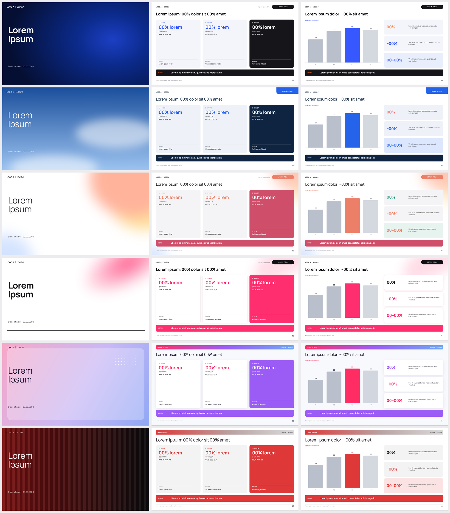
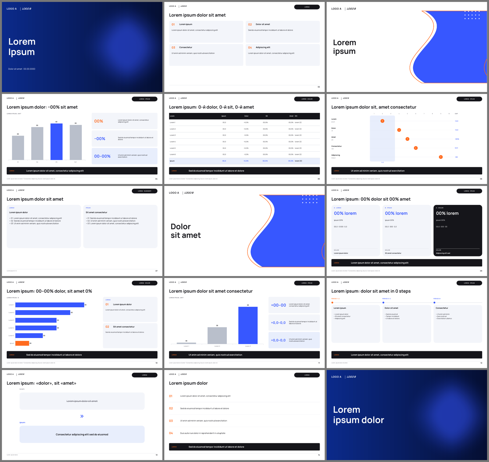
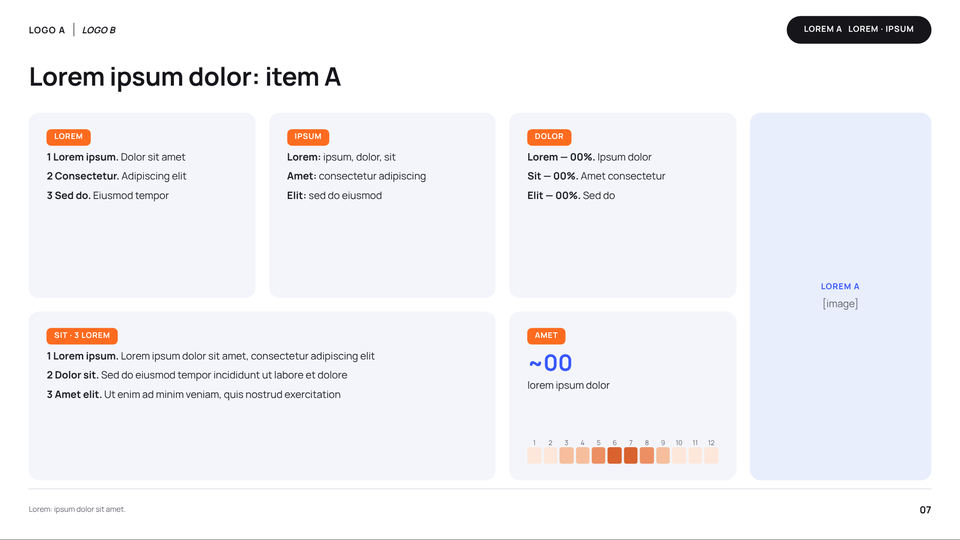
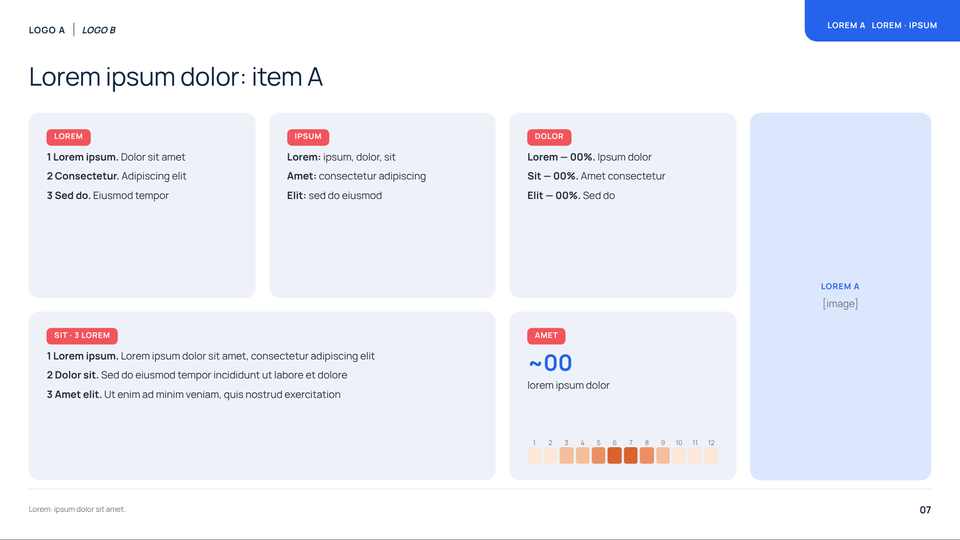
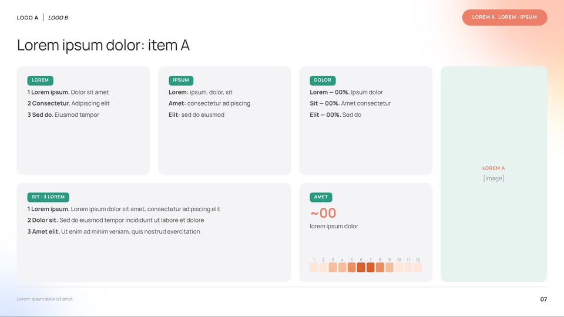
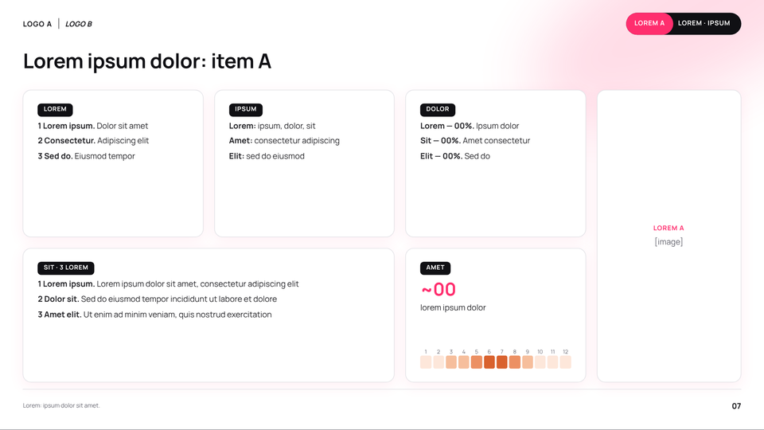
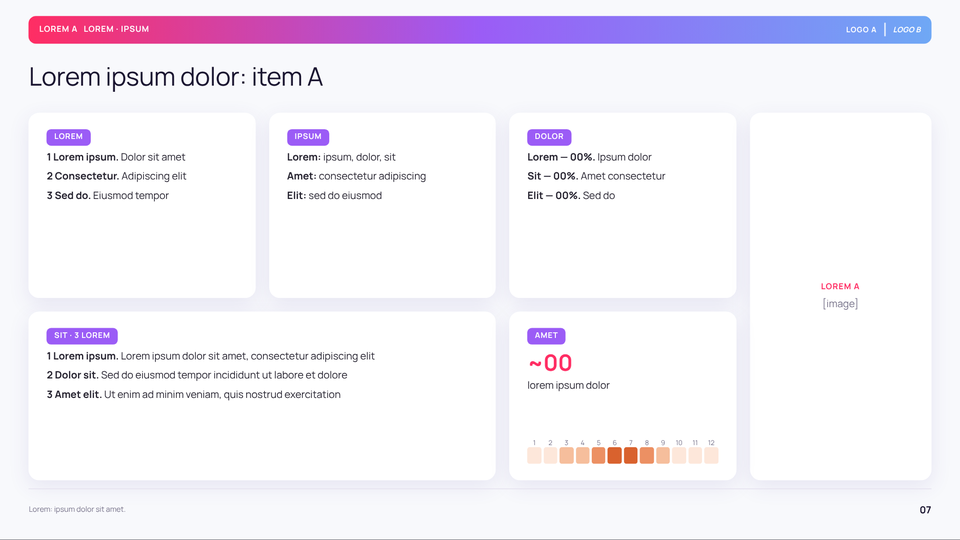
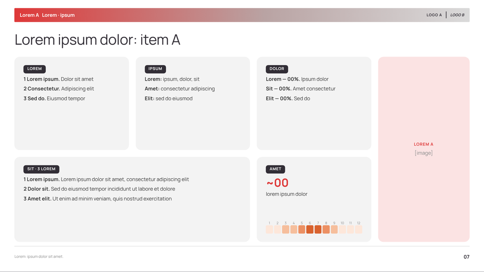

# deck-design-system

**An agent skill for designing presentation decks** — as HTML slides or editable PPTX.
A topic-agnostic design system: slide grammar, 39 layout patterns, chart/table rules and
6 isolated visual themes. All examples are placeholder content (lorem ipsum, `00`).

> RU: Скилл для ИИ-агентов и LLM: дизайн-система презентаций. Общая «грамматика» слайда
> + 6 изолированных визуальных тем. Все примеры — lorem ipsum и цифры-заглушки.



## Two layers

| Layer | Controls | Scope |
|---|---|---|
| **Grammar** | grid, header → title → body → verdict bar → footnote, type scale, components, chart rules, deck structure | shared by every deck |
| **Theme** | colour tokens, title weight, tag shape, cover/divider art, card treatment | exactly one per deck |

The grammar makes a deck readable (titles + verdict bars carry the story); the theme only
sets the mood. Grammar applies everywhere; themes never mix. `accent` is the brand-colour slot.

## Contents

```
SKILL.md                     entry point for the agent
references/
  01-deck-structure.md       deck shapes by length, section recipes, title formulas
  02-slide-grammar.md        grid in %, bands, components, typography, copy rules
  03-layout-catalog.md       39 layout patterns with wireframes (L01–L39)
  04-data-viz.md             chart & table rules
  05-themes.md               6 themes, isolation rules, motif recipes, brand slot
  06-qa-checklist.md         pre-delivery checklist
  07-placeholder-content.md  lorem / 00 conventions for templates
themes/themes.json           single source of tokens (CSS + PPTX)
themes/themes.css            generated CSS variables
templates/deck.html          self-contained HTML deck, all themes, theme switcher
scripts/deckkit.py           PPTX component library
scripts/build_pptx.py        JSON spec → .pptx
scripts/export_pdf.py        HTML deck → PDF / PNG (Playwright)
scripts/gen_theme_css.py     themes.json → CSS
examples/sample-deck.json    14-slide placeholder spec
examples/previews/           rendered previews
evals/evals.json             test prompts
```

## Quick start

```bash
pip install python-pptx lxml playwright && playwright install chromium

python scripts/build_pptx.py examples/sample-deck.json out.pptx --theme bloom --accent "#0A84FF"
python scripts/export_pdf.py templates/deck.html deck.pdf --theme signal --png previews/
```

Font: **Manrope** (Google Fonts, SIL OFL); fallbacks Inter / Arial.

## Using it as a skill

- **Claude Code / Agent SDK**: copy the folder into `.claude/skills/deck-design-system/`
  (project) or `~/.claude/skills/` (user).
- **Claude.ai**: zip the folder and upload it as a skill.
- **Other agents / LLMs**: put `SKILL.md` in the system prompt and give access to `references/`.

## PPTX output (sample spec)



## Themes

| | Theme | Mood |
|---|---|---|
|  | **ledger** | dense, analytical, formal |
|  | **horizon** | calm, structured |
|  | **bloom** | warm, friendly |
|  | **signal** | bold, energetic |
|  | **aurora** | soft, modern |
|  | **ember** | compact, direct |

## License

MIT for code and documentation. Manrope is licensed under the SIL Open Font License.
